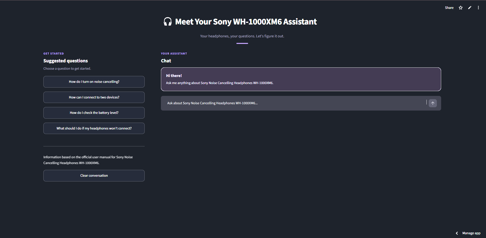
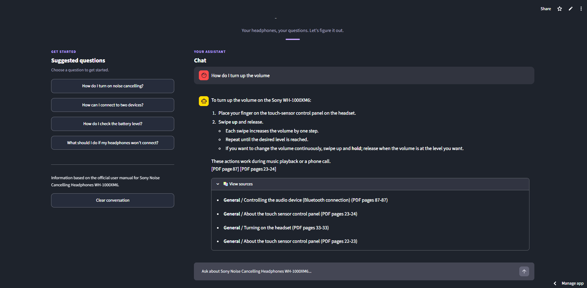

# Sony Noise Cancelling Headphones WH-1000XM6 Assistant

A structure-aware Retrieval-Augmented Generation (RAG) application that answers questions about the **Sony Noise Cancelling Headphones WH-1000XM6** using information retrieved from Sony's official online user manual.

Built with Python, Sentence Transformers, ChromaDB, Groq, and Streamlit, this project explores how document structure and semantic retrieval can help an LLM generate answers grounded in a specific knowledge source.

## Live Demo

**Try the application:** [Sony WH-1000XM6 Assistant](YOUR_STREAMLIT_APP_URL)

No local installation is required. Open the web app, ask a question about the headphones, and review the generated answer and its source references.

> The first request may take longer while the application initializes its models or builds the document index.

## Screenshots

### Full Website Interface



The Streamlit application provides a chat interface with suggested questions to help users explore the headphones' features and troubleshooting instructions.

### Example Question and Answer



Example of the assistant answering a user question using retrieved information from the official manual, with source references displayed when available.

## Official Knowledge Source

This project uses the official online user manual published on Sony's website:

**[Sony Noise Cancelling Headphones WH-1000XM6 Help Guide](https://helpguide.sony.net/mdr/2984/v1/en/index.html)**

The manual serves as the knowledge source for document processing, semantic retrieval, and answer generation. Responses should be checked against the original manual, especially when the retrieved context does not fully support a question.

## Features

- **PDF text extraction:** Extracts manual content using PyMuPDF.
- **Document cleaning:** Reduces formatting noise in extracted text.
- **Structure detection:** Identifies document headings and sections using configurable heuristics.
- **Section-aware chunking:** Splits content into chunks while considering document structure.
- **Semantic embeddings:** Uses Sentence Transformers with `all-MiniLM-L6-v2`.
- **Vector storage and retrieval:** Stores document chunks and metadata in ChromaDB and retrieves relevant passages for user questions.
- **LLM answer generation:** Uses the Groq API to generate answers based on retrieved context.
- **Source references:** Displays available chapter, section, and PDF page metadata.
- **Interactive web interface:** Provides a Streamlit chat experience.
- **Notebook demonstration:** Includes a Jupyter Notebook for exploring the RAG pipeline.

## Architecture

```text
Sony Official User Manual
          |
          v
   PDF Text Extraction
          |
          v
    Document Cleaning
          |
          v
   Structure Detection
          |
          v
  Section-Aware Chunking
          |
          v
 Sentence Transformers
    all-MiniLM-L6-v2
          |
          v
        ChromaDB
      Vector Store
          |
          v
  Semantic Retrieval
          |
          v
   Retrieved Context
          |
          v
    Groq LLM API
          |
          v
 Answer with Sources
```

The pipeline processes and indexes the manual before users ask questions. At query time, it retrieves relevant text chunks and passes them to the LLM to generate a context-grounded answer.

## Tech Stack

| Component | Technology | Purpose |
|---|---|---|
| Programming language | Python | Application and pipeline logic |
| Web framework | Streamlit | Interactive user interface |
| PDF processing | PyMuPDF | Text extraction |
| Embeddings | Sentence Transformers | Semantic text representation |
| Embedding model | `all-MiniLM-L6-v2` | Generates text embeddings |
| Vector database | ChromaDB | Stores and retrieves document chunks |
| LLM API | Groq | Answer generation |
| LLM model | `openai/gpt-oss-20b` | Generates answers using retrieved context |

## Project Structure

```text
sony-rag-assistant/
├── app.py
├── requirements.txt
├── README.md
├── demo.ipynb
├── data/
│   └── Sony_WH1000XM6_UserManual.pdf
└── src/
    ├── config.py
    ├── document_parser.py
    ├── document_cleaner.py
    ├── structure_extractor.py
    ├── chunker.py
    ├── vector_store.py
    ├── retriever.py
    ├── generator.py
    └── rag_pipeline.py
```

The `src/` directory contains the document processing, chunking, embedding, retrieval, and generation components. The `data/` directory contains the source manual, while the vector index is created or accessed according to the application's runtime configuration.

## Run Locally

### Prerequisites

- Python 3.10 or a version supported by the project dependencies
- Git
- A Groq API key
- The Sony official user manual, obtained from an authorized source

### 1. Clone the Repository

```bash
git clone https://github.com/VickyYiiShuChi/sony-rag-assistant.git
cd sony-rag-assistant
```

### 2. Create a Virtual Environment

**Windows:**

```bash
python -m venv .venv
.venv\Scripts\activate
```

**macOS / Linux:**

```bash
python3 -m venv .venv
source .venv/bin/activate
```

### 3. Install Dependencies

```bash
pip install -r requirements.txt
```

### 4. Configure the Groq API Key

**Windows PowerShell:**

```powershell
$env:GROQ_API_KEY="your_groq_api_key"
```

**macOS / Linux:**

```bash
export GROQ_API_KEY="your_groq_api_key"
```

Replace the placeholder with your own API key. Do not commit API keys or other secrets to the repository.

### 5. Prepare the User Manual

Place the manual at the path expected by the application:

```text
data/Sony_WH1000XM6_UserManual.pdf
```

If the PDF is not included in the repository, download or obtain it through an authorized source and place it in the expected location.

### 6. Start the Application

```bash
streamlit run app.py
```

Open the local URL shown in the terminal, usually `http://localhost:8501`.

The first startup may take longer while the embedding model is initialized and the document index is built.

## Limitations

- **Structure detection:** Heading and section detection relies on heuristics and may not always be accurate.
- **Retrieval quality:** Relevant passages may be missed for vague or complex questions.
- **LLM accuracy:** Generated answers may be incomplete or incorrect, even when they sound plausible.
- **Source coverage:** Answers depend on the information available in the official manual and the passages retrieved.
- **Page numbering:** PDF page references may differ from the printed page numbers in the manual.
- **Deployment performance:** Startup time and availability depend on the hosting environment, model initialization, and external API services.

## Future Improvements

- Evaluate retrieval quality using representative questions and expected source passages.
- Add automated tests for document processing, retrieval, and answer generation.
- Improve retrieval through metadata filtering and configurable search parameters.
- Provide more detailed source previews and links to relevant manual sections.
- Improve caching and startup performance.
- Support additional documents and configurable knowledge sources.

## Learning Outcomes

This project provided hands-on experience with document processing, structure-aware chunking, semantic embeddings, vector databases, retrieval-augmented generation, LLM API integration, and deployment of an interactive AI application.

It also demonstrates that building a useful RAG system involves more than connecting an LLM to a vector database. Document quality, chunking strategy, retrieval relevance, context construction, and source verification all influence the quality of generated answers.

## Disclaimer

This is an independent educational project and is not affiliated with, endorsed by, or sponsored by Sony. The application uses Sony's official online user manual as its knowledge source. For authoritative product instructions, refer to the [official Sony Help Guide](https://helpguide.sony.net/mdr/2984/v1/en/index.html).
